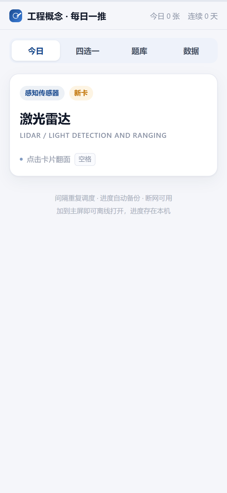
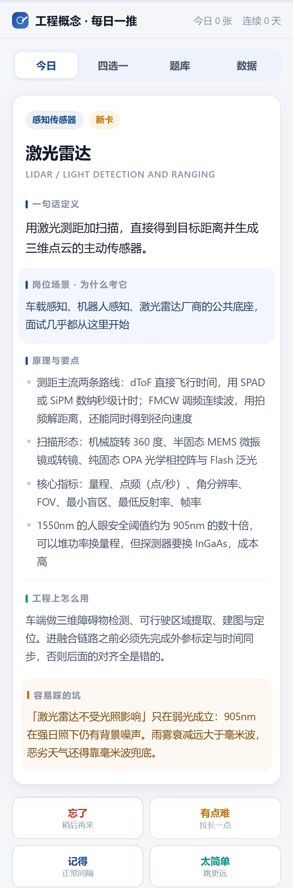
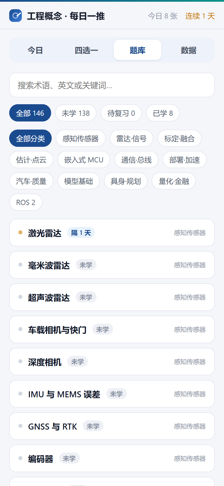
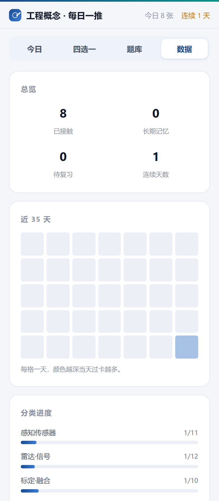
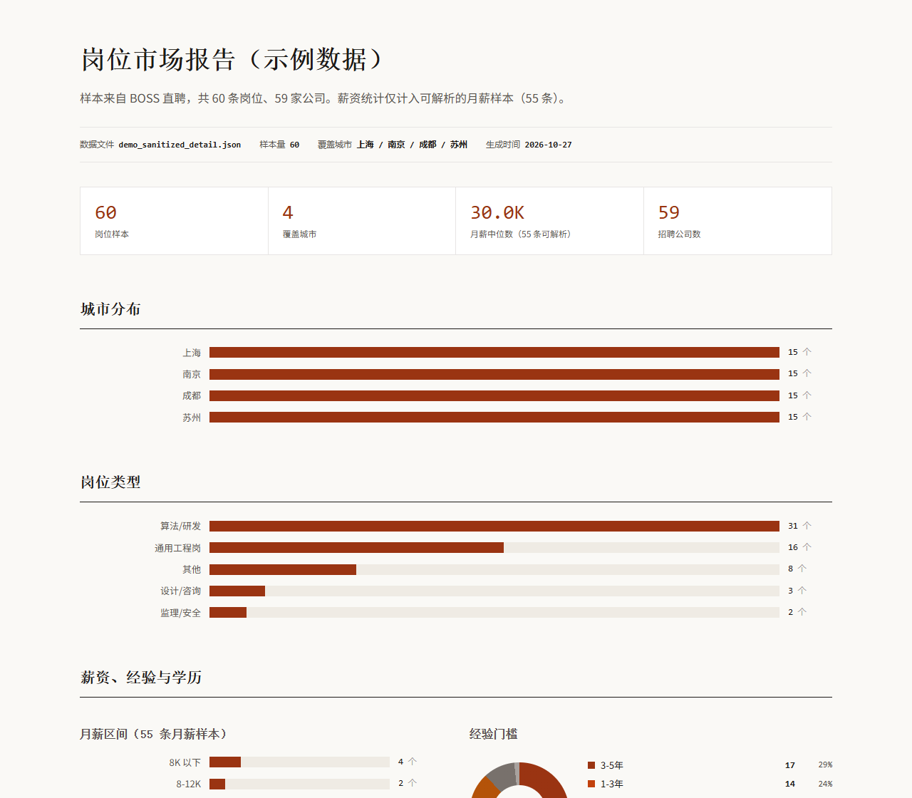
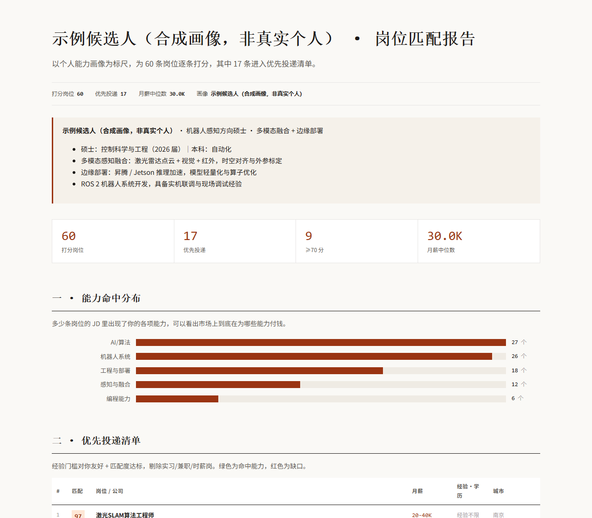

# boss_find_skill · 针对个人简历筛选意向城市的岗位，进而针对岗位需求生成对应的概念复习卡片


> 抓岗位 → 筛出与你方向相关的岗位 → 从 JD 里抽出高频工程概念 → 写成卡片，按间隔重复每天推送。
>
> 输入是一份招聘需求，输出是一套跟着市场实时更新的学习计划。

**一句话**：招聘 JD 是市面上更新最快的技术需求快照。这个项目把它变成可以每天刷的工程概念卡片——不是背题库，而是搞清楚「现在的岗位到底要求你会什么」。

---

## 为什么是「概念卡片」而不是「岗位清单」

市面上的求职工具大多止步于「有哪些岗位」「我匹配多少分」。但真正决定你三个月后能投哪一档岗位的，不是投递效率，而是你补齐了哪些概念。

招聘 JD 恰好是这件事最好的数据源：

| 特性 | 说明 |
|---|---|
| **更新最快** | VLA、扩散策略、世界模型这类新概念，先成规模出现在 JD 里，之后才进入教材和课程 |
| **自带权重** | 一个概念被多少个不同岗位提到，就是它在市场上的真实热度，不用猜 |
| **带上下文** | JD 会告诉你这个概念用在哪、和什么搭配、面试会怎么问，这比孤立的名词解释有用得多 |
| **可行动** | 支持手机，电脑端，不用下载应用程序，点击网站即可开刷 |

所以整条流水线的终点不是一份投递清单，而是 `boss-study` 产出的卡片站点——装到手机主屏，每天 8 分钟。

---

## 工作流

```
boss-setup     装环境（一次性）
     │
boss-scrape    抓岗位 ──────────┐
     │                          │
boss-analyze   市场报告 / 匹配打分 ┴→ 圈定「与目标方向相关」的岗位子集
                                        │
boss-study     抽概念 → 写卡 → 生成站点 → 手机上每天刷   ★ 重点在这
```

前半段（采集、筛选）是手段，后半段（抽概念、成体系、可持续）才是目的。

---

## 卡片长什么样

每张卡八个字段，**核心是最后两个**：它怎么被用、以及你会怎么踩坑。

```json
{
  "cat": "ros2",
  "term": "ROS 2 launch 体系",
  "en": "launch system",
  "one": "launch 用 Python 描述多节点的启动拓扑，替代 rosrun 与手写 shell 脚本。",
  "pts": [
    "launch 文件本身就是 Python 脚本，可以写循环、条件与参数化复用",
    "参数优先级：命令行 > launch 传入 > yaml 默认，顺序搞反就会「改了不生效」",
    "支持定时延迟启动与事件触发启动，用来解耦传感器上电时序"
  ],
  "use": "多传感器节点与算法节点按固定时序一起拉起，换车型只改参数不改代码。",
  "trap": "只改 yaml 不改 launch 里的默认值，运行时仍然是旧参数，表现为「配置文件明明改了却没生效」。",
  "jd": "岗位高频表述：能维护多节点 launch，改参数不用重新编译。面试会追问 launch 传入值与 yaml 默认值的覆盖顺序。",
  "added": "2026-10-26"
}
```

`jd` 字段是这套卡片和普通闪卡最大的区别——**它记录这个概念在招聘需求里是怎么被表述的**，让你知道「为什么考它」。

`merge_cards.py` 会**拒收**写坏了的卡：只喊口号的 `jd`（命中「该岗位要求掌握」这类空话）、废话 `trap`（「注意安全」）、没有任何量化点的 `pts`。

### 手机上的样子

<table>
  <tr>
    <td valign="top" width="33%"></td>
    <td valign="top" width="33%"></td>
    <td valign="top" width="33%"></td>
  </tr>
  <tr>
    <td valign="top"><sub>正面 · 术语与中英文</sub></td>
    <td valign="top"><sub>翻面 · 岗位场景 / 原理 / 用法 / 踩坑</sub></td>
    <td valign="top"><sub>四选一 · 同分类干扰项</sub></td>
  </tr>
</table>

<table>
  <tr>
    <td valign="top" width="50%"></td>
    <td valign="top" width="50%"></td>
  </tr>
  <tr>
    <td valign="top"><sub>题库 · 搜索、状态筛选与分类</sub></td>
    <td valign="top"><sub>数据 · 进度、连续天数、分类覆盖</sub></td>
  </tr>
</table>

> 线上可直接打开体验：<https://ccccty.github.io/study/>（加到主屏后离线可用）

---

### 生成的报告

`boss-analyze` 输出两份单文件 HTML，无 CDN 依赖，双击即可离线查看：

| 报告 | 内容 |
|---|---|
| **岗位市场报告** | 城市分布、岗位类型、薪资 / 经验 / 学历分布、JD 高频词、招聘公司 Top 10、可展开的岗位明细 |
| **岗位匹配报告** | 个人能力画像 → 逐条打分 → 优先投递清单，每条标注命中的能力与缺口标签 |





> 上图由仓库内脚本在**脱敏示例数据**上重新生成：公司名统一替换为公司 A/B/C…，岗位链接与 JD 原文已截断，候选人为合成画像，不含任何真实个人或企业信息。

---

## 四个 Skill

| Skill | 作用 | 关键点 |
|---|---|---|
| `boss-setup` | 一键配置 CloakBrowser + Playwright | 装完自检反检测是否生效 |
| `boss-scrape` | 两阶段抓取：先翻列表，再按相关性只取候选详情 | 请求量砍 60%+，列表可复用反复调过滤条件 |
| `boss-analyze` | 市场分析 HTML 报告 + 按简历画像打分 + 推荐清单 | 识别「分高但投不了」的陷阱岗位 |
| `boss-study` | **岗位概念抽取 → 八字段卡片 → 间隔重复站点** | 直接产出手机上可用的学习产品 |

脚本**随包提供**，不是让模型现场生成代码——同样输入得到同样输出，也方便你自己改。

---

## 快速开始

```bash
git clone https://github.com/ccccty/boss_find_skill.git
cp -r boss_find_skill/skills/* ~/.claude/skills/          # Claude Code
# 或：cp -r boss_find_skill/skills/* ~/.workbuddy/skills/    # WorkBuddy
```

Windows 用 `xcopy /E /I skills\* %USERPROFILE%\.workbuddy\skills\`。装完重启会话即可被识别。

### 1. 配环境（一次性，约 10 分钟，主要是下 500 MB 浏览器）

```bash
mkdir boss-jobs && cd boss-jobs
python -m venv .venv
.venv/Scripts/python.exe -m pip install "cloakbrowser[geoip]" jieba
.venv/Scripts/python.exe -m playwright install chromium
```

> macOS / Linux 把 `.venv/Scripts/` 换成 `.venv/bin/`。

### 2. 抓岗位

```bash
python skills/boss-scrape/scripts/scraper.py \
  --keywords "具身智能,机器人算法,激光雷达算法" \
  --cities "上海,南京,苏州" \
  --strong "具身,机器人,激光雷达,多模态" \
  --noise "销售,客服,培训" \
  --max-details 60 --out data
```

首次会弹浏览器扫码登录，登录态存 `data/cookies.json`，之后自动复用。

### 3. 出报告 / 匹配清单

```bash
# 市场分析
python skills/boss-analyze/scripts/analyze.py --input data/xxx_detail.json --out reports/岗位报告.html

# 按简历匹配
python skills/boss-analyze/scripts/match.py --init profile.json
python skills/boss-analyze/scripts/match.py --input data/xxx_detail.json \
  --profile profile.json --out data/matched.json \
  --csv "data/推荐清单.csv" --html reports/匹配报告.html
```

### 4. 做概念卡片（重点）

```bash
# 抽候选术语：按「被多少个不同岗位提到」排序，不是词频
python skills/boss-study/scripts/extract_terms.py \
  --input data/xxx_detail.json --top 60 --out data/terms.json

# 挑出能讲原理的概念，按八字段写卡，校验后入池（会拒收空话卡）
python skills/boss-study/scripts/merge_cards.py \
  --cards my-study/cards.json --input cands/2026-10-26.json --dry-run

# 生成站点（一个领域一个站）
python skills/boss-study/scripts/build_site.py \
  --out my-study --title "机器人感知 · 每日一推" --short "感知卡"
```

站点是纯静态的，push 到 GitHub Pages 后手机加到主屏即可每天刷。详见 `skills/boss-study/SKILL.md` 与 `references/card_writing.md`。

线上实例：<https://ccccty.github.io/study/>

---

## 抽概念为什么需要一整套清洗

从 JD 正文里找术语看着简单，实际一半工作量在清噪音。实测（153 条数据安全岗）：

| 噪音类型 | 实测表现 | 处理方式 |
|---|---|---|
| 反爬水印插在词内部 | `kanzhun` 出现 21 次，把「抖音」切成「抖kanzhun音」 | 删水印（不补空格），被切开的词自动复原 |
| 康熙部首冒充汉字 | **532 个** `⽇`（U+2F47）这类字符，肉眼看不出 | NFKC 归一化还原成「日」 |
| 跨词碎片 | `数据分`（数据/分析）、`沟通协`（沟通/协调） | 分词边界一致率 < 0.75 丢弃 |
| 单侧固定碎片 | `据安全`（左边永远是「数」） | 左右邻接字熵 < 1.0 bit 丢弃 |

漏斗：**6820 个候选 → 熵过滤 1036 → 边界过滤 725 → 虚词词性 698 → top 60**。

排序用**提及岗位数**而不是词频——同一个 JD 里出现 20 次，可能只是那家公司的口头习惯。

---

## 实测数据

一次真实运行（5 城 × 9 关键词，2026-10）：

| 阶段 | 数量 | 耗时 |
|---|---|---|
| 列表页采集 | 1633 条 | ~28 min |
| 相关性过滤 | 639 条 → 取 550 条 | 秒级 |
| 详情页抓取 | 550 条 | ~34 min |
| **合计** | | **~62 min** |

同一批数据若全量抓详情，需要 1633 × 4s ≈ 110 min。

<details>
<summary>为什么两阶段采集</summary>

BOSS 单关键词召回上限约 90 条，而详情页是主要成本（每条约 4 秒）。列表页只有标题/公司/地点，很便宜。先把所有关键词的列表翻完，再按「目标城市 + 岗位相关性」排序截断，只对候选抓详情——请求量砍掉 60%+，列表数据还能复用（`--reuse-list`）反复调过滤条件。

</details>

<details>
<summary>三个平台坑（都已写进脚本）</summary>

1. **`city` 参数会失效**：目标城市岗位少时返回全国岗位，必须按 `location` 字段二次过滤。
2. **冷门关键词会被降级**：搜「航道工程」可能返回「算法工程师」「酒店前台」，平台用泛结果填空。
3. **关键词会误命中**：`水工` → 「送水工」，`会计` → 「电话销售」，用 `--noise` 剔掉。

</details>

---

## 已知限制

- 需要**有图形界面**的环境（`headless=False` 弹浏览器扫码），纯服务器跑不了登录
- 首次要下约 500 MB 定制 Chromium，国内 8–10 分钟
- 城市名要用简称，冷门城市查不到编码会直接报错（可在 `cities.py` 的 `BUILTIN` 补）
- 同时只能开一个 CloakBrowser 实例
- 匹配分是规则打分，衡量「JD 与你能力的重合度」，**不是录取概率**
- 卡片质量最终取决于写卡的判断力，脚本只能拒收明显写坏的卡

---

## 免责声明

本项目仅供**个人学习与技术研究**使用，用于探讨数据采集、文本清洗与知识组织方法。

请勿用于任何违反 [BOSS 直聘用户协议](https://www.zhipin.com/about/protocol.html) 或相关法律法规的用途；不得用于商业转售、恶意抓取或对目标站点造成负担的行为。请控制请求频率，遵守目标站点的 robots 协议，只采集登录后可正常浏览的公开岗位信息。

使用本项目所产生的一切后果由使用者自行承担，作者不对任何滥用行为负责。

---

## 致谢

本项目的设计与实现受益于以下开源工作：

- **[eatmoreduck/boss-zhipin-scraper](https://github.com/eatmoreduck/boss-zhipin-scraper)** —— 感谢作者。该项目通过 Chrome DevTools Protocol 复用本地已登录浏览器的真实登录态、绕开前端字体反爬直接取明文薪资，并完整实现了增量写入、跨轮新增标记与多维筛选，是本领域实现最完整的一份开源参考。本项目在「复用真实登录态」「把采集与后续分析彻底分离」「用免责声明划清使用边界」这几点上受其影响很大。
- **[TreeWalk/boss-zhipin-skill](https://github.com/TreeWalk/boss-zhipin-skill)** —— `boss-setup` / `boss-scrape` / `boss-analyze` 三个 skill 的初始骨架来自该项目；后续在随包脚本化、两阶段采集、打分模型与报告组件上做了较大重写。

如实说明：本仓库不是上述任何项目的 fork。采集端使用 CloakBrowser + Playwright 独立实现；`boss-study` 与整套卡片体系为本项目自行设计。

---

## License

MIT
